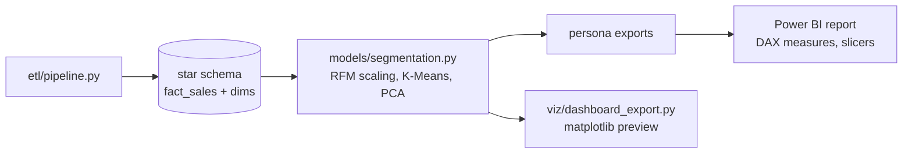
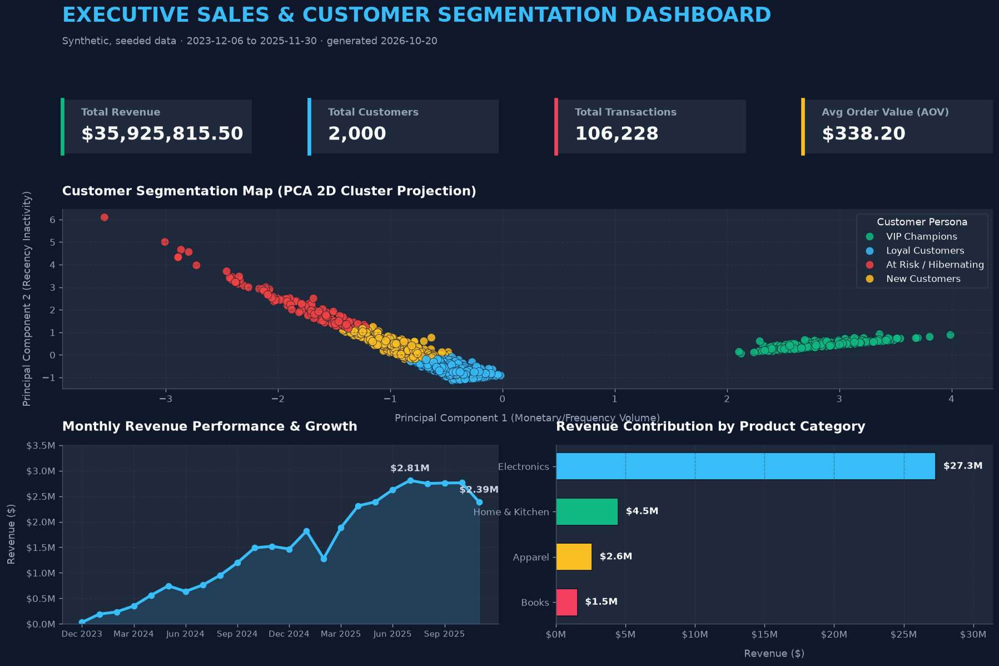

# Sales Analytics & RFM Customer Segmentation

[](https://github.com/Deshraj-Jogiya/Sales-Customer-Segmentation-Pipeline/actions/workflows/ci.yml) 

A star-schema sales pipeline that scores customers on recency, frequency and monetary value (RFM), groups them into personas with K-Means,
and feeds an interactive Power BI report.

## Highlights

- **Star schema** (`fact_sales` plus customer and product dimensions) holding 106,228 synthetic transactions for BI reporting.
- **RFM + K-Means:** scaled RFM features clustered into 4 customer personas; the clusters explain 93.9% of the variance in the scaled RFM features, and a 2-D PCA view keeps 99.6% of it.
- **Power BI report** (`powerbi/sales_dashboard.pbix`): star-schema relationships, DAX measures, a K-Means cluster scatter plot and a
  persona slicer.
- **Pareto analysis:** the top 20% of customers bring in 79.9% of revenue, and the analysis isolates the segments behind it.
- **A bug found and fixed:** the persona mapping let two personas collapse onto one cluster, silently dropping "VIP Champions". It now
  asserts that every persona is assigned, and `tests/test_segmentation.py` covers it.

Measured results, each with the question, the test and the decision: [docs/FINDINGS.md](docs/FINDINGS.md).

## Architecture





## Stack

Python, SQL, pandas, scikit-learn (K-Means, PCA), Seaborn, Power BI, DAX, GitHub Actions.

## Run it

```bash
pip install -r requirements.txt
python etl/pipeline.py
python models/segmentation.py
python viz/dashboard_export.py
python -m unittest tests.test_segmentation -v
```

Open `powerbi/sales_dashboard.pbix` in Power BI Desktop for the interactive report.

## Data

Transactions are generated by the pipeline (synthetic, seeded): 2,000 customers, 20 products and 106,228 transactions over two years
(2023-12-06 to 2025-11-30), drawn so that 20% of customers account for about 80% of purchases. It is not a real retailer's data.
The generator is vectorised, so the full run takes a few seconds.
